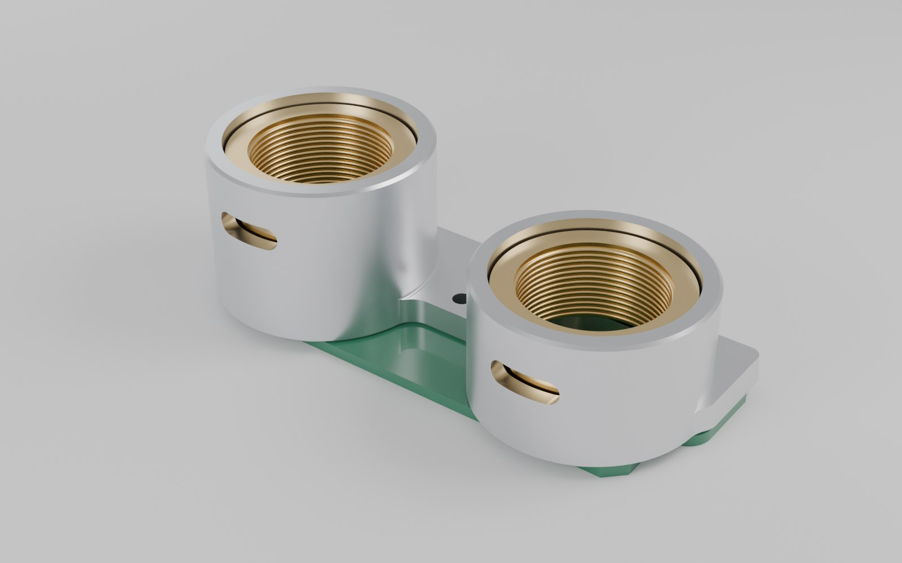
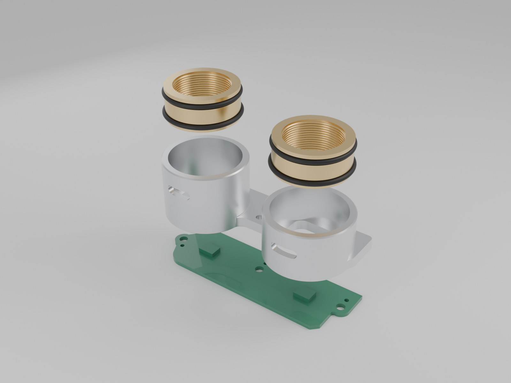

# Derrick Prototype Challenge



Derrick is comma.ai's in-house prototype shop. It has a Haas VF-2SS, a manual lathe, a row of Bambu H2Ds and a Form 4.

We're hiring the person who runs it. That person gets a STEP file, sometimes a rough drawing, and a deadline that's usually "tomorrow." They pick the material and the process, fix anything that can't be made without asking anyone, and hand back a part. They also own mechanical projects like the [comma body](https://comma.ai/shop/body).

This challenge is a normal Tuesday at Derrick.

## The request

> **Tuesday, 4:30 pm**
>
> hey, need 2 lens testers by 10am tomorrow. camera team is testing new lenses first thing.
>
> STEP and a quick drawing are in the repo. 2 inserts per tester.
>
> also, people keep pulling the inserts out with pliers and chewing them up. make us something to get them out without pliers. has to work whether or not a lens is screwed in.
>
> thx

## What you're making



A lens tester. A machined aluminum body holds two M12 lenses over the two image sensors on a PCB. Each lens screws into a threaded insert (the drawing and STEP call them adapters), and each insert sits in a Ø16 bore on two O-rings. The PCB screws to the bottom of the body.

Everything is in `cad/lens_tester_revA.step`: the body, both inserts, and a model of the PCB. The PCB is an existing board, so its outline and holes can't change. The quick drawing is `drawings/lens_tester_revA.pdf`.

## Ground rules

- **No questions, with one exception.** You get exactly one message to the requester. It goes out tonight. Assume no reply before 7:00 am, and maybe none at all. Decide everything else yourself and write down your assumptions. Anything else the requester should know goes in your 10am handoff note.
- **Fix what can't be made.** If a feature can't be made with what's in the shop by 10am, change it.
- **The mill is 3-axis this week.** The trunnion is off for service.
- **The shop is what's in `shop/`.** Tools, stock, supplies and machine state are as listed. Supplier lead times are in `shop/suppliers.md`.
- **You're alone tonight.** You can work until 11:00 pm and you're back at 7:00 am. The Haas only runs while you're in the shop: running the lathe while the Haas cuts is fine. Printers can run overnight.
- **CAM in Fusion.** The free Personal license or a trial covers everything we ask for: 3-axis toolpaths and simulation. No G-code needed.

## What to send

Copy `SUBMISSION_TEMPLATE.md` to `answers.md` and fill it in. Bullet points and sketches beat essays.

```text
answers.md     the template, filled in (at the root of your zip)
revised_cad/   STEP of the body as you'd actually make it (insert changes can be a table in answers.md)
cam/           Fusion file (.f3d or .f3z) + 2-3 screenshots
extractor/     STEP of your extractor + a section view or sketch
sketches/      optional: photos of hand sketches are welcome
```

**CAM.** Program **one** setup of the body in Fusion, on your revised CAD: the setup that cuts the bores, with all of its operations, tools, feeds and speeds. Include screenshots of the setup (stock and WCS), the operation list, and the final simulation. For the other setups, a short list is enough: workholding, tools, and what gets cut.

**Extractor.** It should be something Derrick can make by 10am. Tell us the printer, material, orientation, supports, any hardware, and how to use it. Then: if comma's factory needed 5,000 of them, what would you change so it can be injection molded? 5-10 lines. A marked-up sketch or screenshot helps but isn't required.

**One idea for Derrick.** What's one thing you'd build or change in your first month that would make every future job faster? 5-10 lines.

## Time

Aim for about 4 hours. If you're running long, cut detail, not decisions. A physical part is not required.

## How we read it

- **Judgment.** What you changed, what you left alone, what you told us, and what you spent your one message on.
- **Craft.** Could we run your plan tonight? Stock, setups, workholding, tools, the CAM, the inserts, the timeline.
- **Ideas.** The extractor and your Derrick idea. Clever, simple and actually works beats complicated.
- **Communication.** Short and clear.

Length doesn't earn points. A great submission can be two pages plus files.

## Files

```text
cad/
  lens_tester_revA.step     body, 2 inserts, and the PCB
drawings/
  lens_tester_revA.pdf      the "quick drawing"
imgs/
  lens_tester.jpg
  lens_tester_exploded.jpg
shop/
  machine_notes.md
  maintenance_log.md
  tool_library_mill.csv
  tool_library_lathe.csv
  stock_list.csv
  inventory.csv
  printer_materials.csv
  suppliers.md
SUBMISSION_TEMPLATE.md
```

## Submission

Zip your submission with `answers.md` at the root. We accept STEP for CAD, .f3d or .f3z for CAM, and PNG, JPG or PDF for images. If the form rejects the size (usually a big .f3d), put a download link in `answers.md` instead.

Send it through the Google Form, choosing the `prototype` challenge type:

https://forms.gle/coTBB9UoYGNiunyN7

Do not submit solutions as GitHub issues or pull requests.

If we like it, next come a couple of calls, then a paid micro-internship working in the shop.
